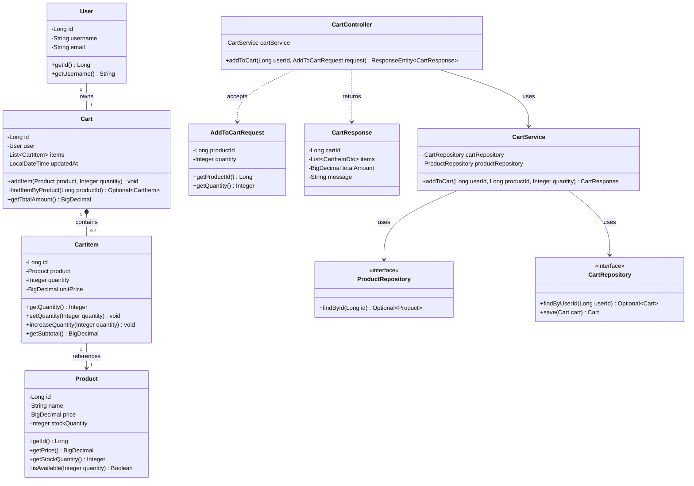
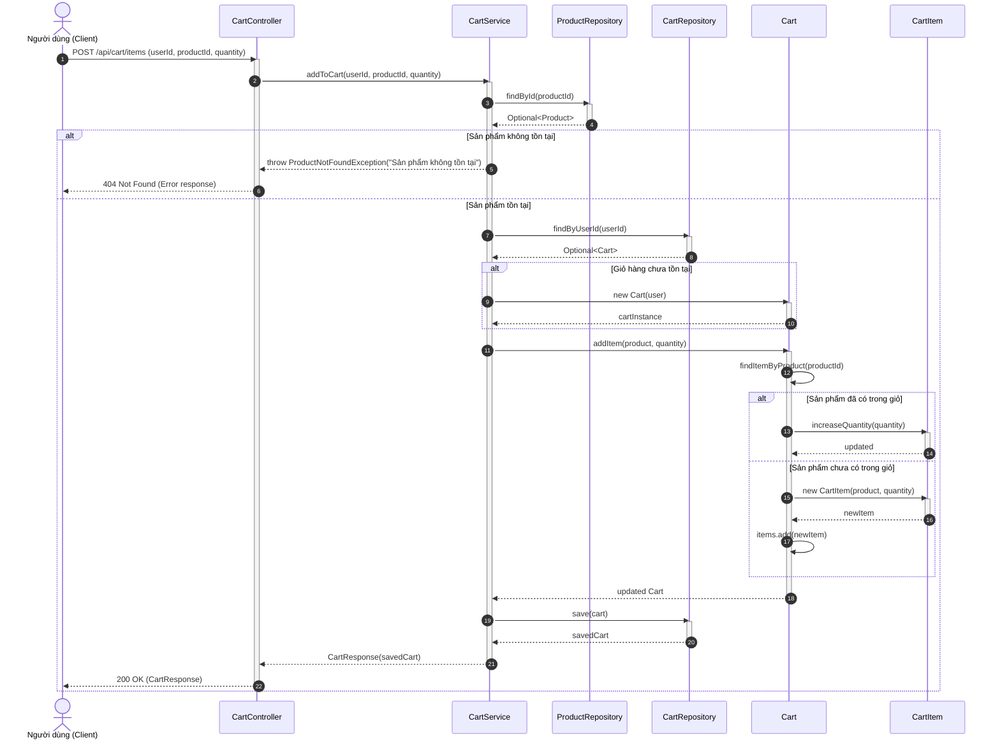

# Bài 30: Thiết Kế Tính Năng "Thêm Sản Phẩm Vào Giỏ Hàng"

Dự án này chứa tài liệu thiết kế hệ thống chi tiết cho tính năng **Thêm sản phẩm vào giỏ hàng** (Add to Cart) theo mô hình Layered Architecture / MVC (Spring Boot / Java style), bao gồm:
1. **Sơ đồ Lớp (Class Diagram)** bằng Mermaid.
2. **Sơ đồ Tuần tự (Sequence Diagram)** bằng Mermaid.
3. Kịch bản chi tiết bao gồm xử lý logic khi sản phẩm tồn tại/không tồn tại, giỏ hàng đã có mặt hàng hay tạo mới.

---

## 1. Sơ đồ Lớp (Class Diagram)

---

## 2. Sơ đồ Tuần tự (Sequence Diagram)

---

## 3. Mô Tả Luồng Xử Lý (Use Case Detailed Logic)

1. **Tiếp nhận Yêu cầu**:
   - Controller tiếp nhận request `POST /api/cart/items` từ Người dùng (đã xác thực JWT/Session -> có `userId`).
2. **Kiểm tra Sản phẩm**:
   - Service gọi `ProductRepository.findById(productId)` để tìm thông tin sản phẩm X.
   - Nếu không tìm thấy, hệ thống dừng xử lý và trả về lỗi `404 Not Found`.
3. **Quản lý Giỏ hàng**:
   - Service kiểm tra người dùng đã có giỏ hàng trong CSDL chưa bằng `CartRepository.findByUserId(userId)`.
   - **Trường hợp A**: Chưa có giỏ hàng -> Tạo mới đối tượng `Cart` gán cho `userId`.
   - **Trường hợp B**: Đã có giỏ hàng -> Lấy đối tượng `Cart` hiện tại ra xử lý.
4. **Cập nhật Mặt hàng (CartItem)**:
   - Gọi phương thức `cart.addItem(product, quantity)`:
     - Kiểm tra sản phẩm X đã xuất hiện trong `cart.items` hay chưa.
     - Nếu **ĐÃ CÓ**: Tìm `CartItem` tương ứng và gọi `increaseQuantity(quantity)`.
     - Nếu **CHƯA CÓ**: Tạo một đối tượng `CartItem` mới với `product` và `quantity` rồi thêm vào danh sách `items`.
5. **Lưu dữ liệu & Trả về**:
   - Gọi `CartRepository.save(cart)` để lưu thông tin cập nhật vào CSDL.
   - Trả về DTO `CartResponse` thông báo thành công cho client kèm chi tiết giỏ hàng và tổng tiền.
