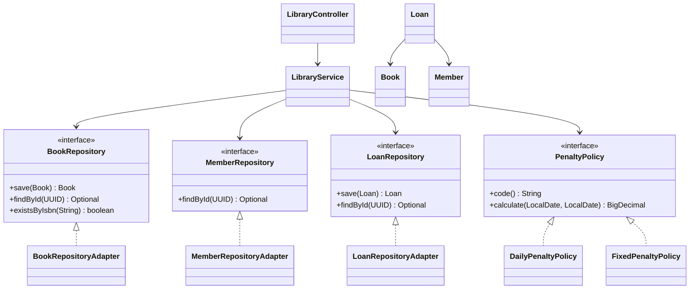

# Library Management System – SOLID (Bài 29)

Ứng dụng quản lý thư viện đơn giản viết bằng **Java 17 + Spring Boot 3 + Spring Data JPA + H2**. Dự án minh họa cách tách lớp theo hướng phụ thuộc vào abstraction, đồng thời hỗ trợ nhiều chính sách phí phạt khi trả sách muộn.

## 1. Chức năng

- Đăng ký thành viên mới (kiểm tra email hợp lệ).
- Thêm sách mới (kiểm tra ISBN không trùng).
- Thành viên mượn sách đang có sẵn. Thời hạn mượn mặc định 14 ngày.
- Trả sách; hệ thống tính phí phạt theo chính sách được chọn.
- Hai chính sách phí phạt có sẵn:
  - `DAILY`: 5.000 VND cho mỗi ngày trễ.
  - `FIXED`: 30.000 VND một lần nếu trả trễ.
- REST API, validation đầu vào, xử lý lỗi tập trung.
- H2 database chạy trong bộ nhớ; phù hợp demo và học tập.

> Có thêm API tạo thành viên để bạn chạy thử luồng mượn sách end-to-end.

## 2. Kiến trúc và class diagram

Kiến trúc được chia thành `api`, `application`, `domain`, `infrastructure`. Application chỉ biết các repository interface; adapter ở infrastructure chịu trách nhiệm giao tiếp Spring Data JPA.



## 3. Cấu trúc thư mục

```text
src/main/java/com/example/library/
├── LibraryApplication.java
├── api/
│   ├── LibraryController.java
│   ├── ApiExceptionHandler.java
│   └── dto/
├── application/
│   ├── LibraryService.java
│   ├── ResourceNotFoundException.java
│   ├── penalty/
│   │   ├── PenaltyPolicy.java
│   │   ├── DailyPenaltyPolicy.java
│   │   └── FixedPenaltyPolicy.java
│   └── port/
│       ├── BookRepository.java
│       ├── MemberRepository.java
│       └── LoanRepository.java
├── domain/
│   ├── Book.java
│   ├── Member.java
│   └── Loan.java
└── infrastructure/persistence/
    ├── *RepositoryAdapter.java
    └── springdata/
        └── SpringData*Repository.java
```

## 4. Giải thích SOLID

### S – Single Responsibility Principle

- `LibraryController`: nhận HTTP request, validate DTO và trả response.
- `LibraryService`: điều phối nghiệp vụ thêm sách, mượn và trả sách.
- `Book`, `Member`, `Loan`: giữ dữ liệu và hành vi thuộc domain.
- Mỗi `PenaltyPolicy`: chỉ chịu trách nhiệm tính một kiểu phí phạt.
- Các `*RepositoryAdapter`: chuyển tiếp thao tác lưu trữ sang Spring Data JPA.

Không gom HTTP, tính phí, nghiệp vụ và truy cập database vào một class duy nhất.

### O – Open/Closed Principle (đặc biệt: phí phạt)

`LibraryService` phụ thuộc vào `PenaltyPolicy`, không phụ thuộc trực tiếp vào `DailyPenaltyPolicy` hay `FixedPenaltyPolicy`.

Khi cần chính sách mới, ví dụ phạt theo phần trăm giá sách hoặc theo số tuần trễ:
1. Tạo class mới implements `PenaltyPolicy`.
2. Implement `code()` và `calculate(...)`.
3. Đánh dấu `@Component`.

Spring tự đưa implementation mới vào `List<PenaltyPolicy>` được inject trong `LibraryService`. Không cần sửa logic trả sách. Đây là mở rộng bằng cách thêm implementation, hạn chế sửa code đã ổn định.

Ví dụ khung mở rộng:

```java
@Component
public class WeeklyPenaltyPolicy implements PenaltyPolicy {
    @Override
    public String code() { return "WEEKLY"; }

    @Override
    public BigDecimal calculate(LocalDate dueDate, LocalDate returnedDate) {
        // Tự định nghĩa quy tắc tính theo tuần.
        return BigDecimal.ZERO;
    }
}
```

### L – Liskov Substitution Principle

Mọi implementation của `PenaltyPolicy` đều có thể được sử dụng thay thế cho implementation khác trong `LibraryService`. Chúng tuân thủ cùng hợp đồng: nhận ngày đến hạn và ngày trả, trả về số tiền phạt không âm; trả đúng hạn hoặc sớm thì không phạt.

### I – Interface Segregation Principle

Không tạo một interface repository khổng lồ cho mọi loại dữ liệu. Tách `BookRepository`, `MemberRepository`, `LoanRepository` theo nhu cầu của từng aggregate. Mỗi adapter chỉ triển khai đúng hợp đồng cần thiết.

### D – Dependency Inversion Principle (đặc biệt: lưu trữ dữ liệu)

- `LibraryService` (application/high-level) phụ thuộc vào các interface repository trong `application.port`.
- `LibraryService` không import `JpaRepository`, không biết H2, SQL hay cách lưu dữ liệu.
- `BookRepositoryAdapter`, `MemberRepositoryAdapter`, `LoanRepositoryAdapter` (infrastructure/low-level) triển khai các interface đó và dùng Spring Data JPA bên dưới.

Muốn thay H2 bằng PostgreSQL hoặc MongoDB, có thể viết adapter khác mà không phải viết lại nghiệp vụ trong `LibraryService`. Đây là DIP và kiến trúc ports-and-adapters ở mức đơn giản.

## 5. Chạy ứng dụng

Yêu cầu:
- JDK 17+
- Maven 3.6+

Tại thư mục dự án:

```bash
mvn clean test
mvn spring-boot:run
```

Ứng dụng chạy tại `http://localhost:8080`.

H2 Console: `http://localhost:8080/h2-console`

Thông tin kết nối:
- JDBC URL: `jdbc:h2:mem:librarydb`
- User: `sa`
- Password: để trống

## 6. REST API

### Tạo thành viên

`POST /api/members`

```json
{
  "fullName": "Nguyen Van A",
  "email": "a@example.com"
}
```

Response trả về `id` của thành viên; dùng ID này cho API mượn sách.

### Thêm sách

`POST /api/books`

```json
{
  "title": "Clean Code",
  "author": "Robert C. Martin",
  "isbn": "9780132350884"
}
```

Response mẫu:

```json
{
  "id": "UUID",
  "title": "Clean Code",
  "author": "Robert C. Martin",
  "isbn": "9780132350884",
  "available": true
}
```

### Mượn sách

`POST /api/loans`

```json
{
  "memberId": "UUID_CUA_THANH_VIEN",
  "bookId": "UUID_CUA_SACH"
}
```

Response có `loanId`, `borrowedAt`, `dueAt`. Thời hạn mặc định là 14 ngày.

### Trả sách – phạt theo ngày

`POST /api/loans/{loanId}/return`

```json
{
  "penaltyPolicy": "DAILY"
}
```

### Trả sách – phạt cố định

```json
{
  "penaltyPolicy": "FIXED"
}
```

Chỉ chọn một chính sách cho một lần trả. Ví dụ, nếu trễ 3 ngày:
- `DAILY`: 15.000 VND.
- `FIXED`: 30.000 VND.

## 7. Ghi chú phạm vi demo

- Phí phạt và thời hạn mượn là hằng số minh họa; trong hệ thống thực tế nên đưa vào cấu hình hoặc bảng chính sách.
- H2 `mem` lưu dữ liệu trong RAM, dữ liệu mất khi ứng dụng dừng.
- Dự án chưa xử lý đồng thời nâng cao (hai người mượn cùng lúc), giới hạn số sách mỗi thành viên, gia hạn, thanh toán phí phạt hoặc phân quyền.
- Với production, nên bổ sung migration (Flyway/Liquibase), database bền vững, optimistic/pessimistic locking và kiểm thử integration.
