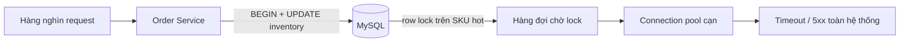
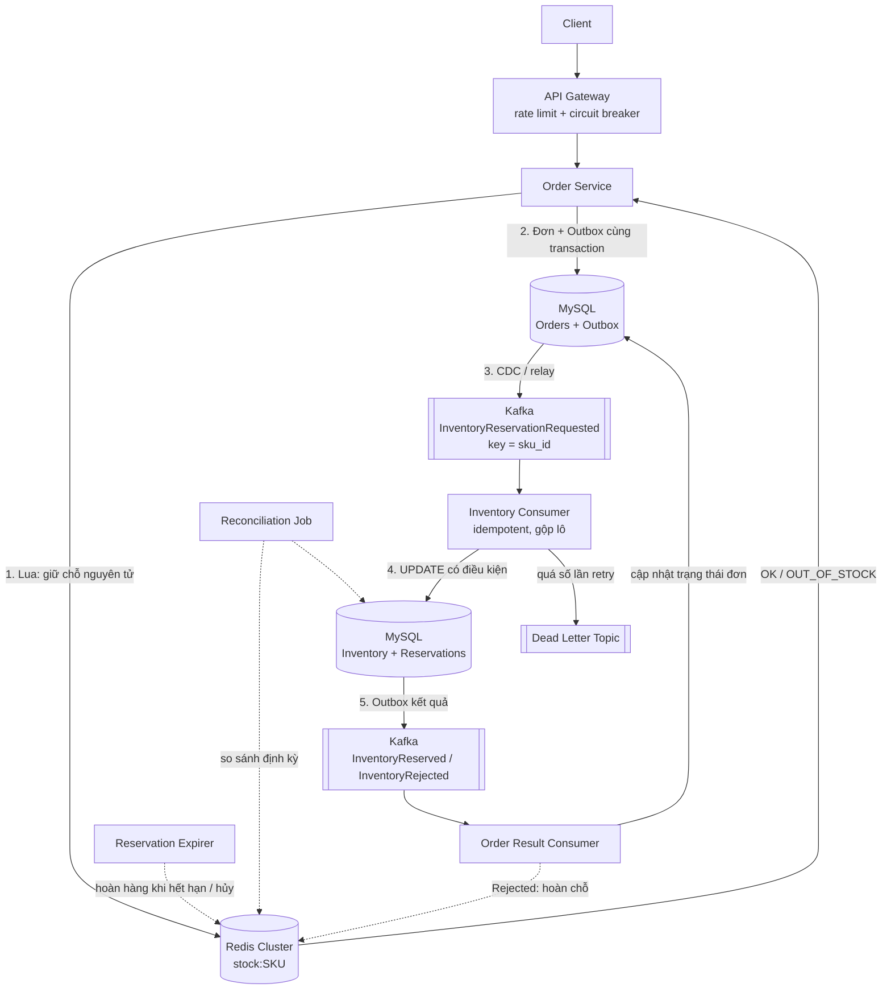
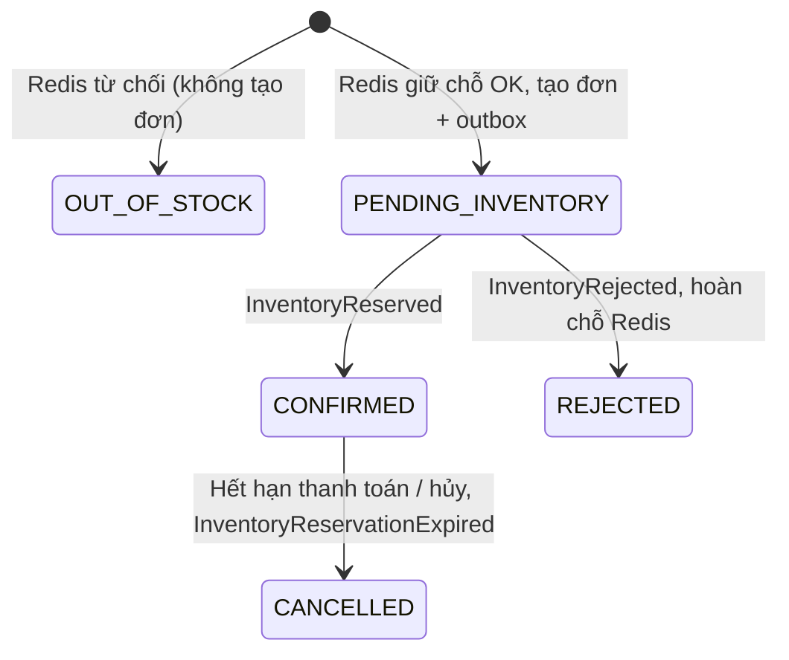

# ADR-0033: Tái thiết kế Trừ kho (Inventory Decrement) bằng Redis Atomic Reservation + Kafka Async Persistence

| Thuộc tính | Giá trị |
|---|---|
| **Trạng thái** | Proposed (Đề xuất – chờ review) |
| **Ngày** | 2026-11-10 |
| **Người quyết định** | Architecture Board / Tech Lead nhóm Order & Inventory |
| **Phạm vi** | Quy trình đặt hàng và giữ/trừ tồn kho: Order Service, Inventory Service, hạ tầng Redis / Kafka / MySQL |
| **Thay thế** | Cơ chế hiện tại: `UPDATE inventory SET qty = qty - ?` chạy đồng bộ trong transaction đặt hàng trên MySQL |
| **Liên quan** | Sự cố sập hệ thống giờ cao điểm (flash sale, khuyến mãi, khung giờ vàng) |

> **Nguồn gốc số liệu.** Mọi con số trong tài liệu được gắn một trong ba nhãn:
> - **[ĐO]** – đo trực tiếp ngày 2026-11-10 bằng `redis-benchmark` (Redis 7.0.15) và một test đồng thời tự viết, trên VM 2 vCPU / 8 GB RAM (cách tái lập ở Phụ lục A).
> - **[TÍNH]** – suy ra bằng công thức (thông lượng tối đa của một row lock = 1 / thời gian giữ lock, Định luật Little) từ các số [ĐO] và [ĐẦU VÀO].
> - **[ĐẦU VÀO]** – thông số của kịch bản bài toán (đề bài không cung cấp số liệu hệ thống thật), nêu rõ ở mục 1.4 để người đọc có thể thay bằng số của mình và tính lại.
>
> Phần MySQL **không** đo trực tiếp (môi trường làm bài không có MySQL) mà **tính** từ công thức; cách kiểm chứng bằng `sysbench` ở Phụ lục A.

---

## 1. Bối cảnh (Context)

### 1.1 Hiện trạng

Khi khách bấm "Đặt hàng", `Order Service` mở một transaction MySQL và gọi trực tiếp bước trừ kho:

```sql
BEGIN;
UPDATE inventory SET qty = qty - ? WHERE sku_id = ? AND qty >= ?;
INSERT INTO orders ...;
INSERT INTO order_items ...;
INSERT INTO inventory_log ...;
COMMIT;
```

Toàn bộ luồng chạy **đồng bộ** và **chung một database** với các nghiệp vụ khác (đơn hàng, thanh toán, báo cáo).

### 1.2 Vấn đề

Vào giờ cao điểm, hệ thống sập. Chuỗi nguyên nhân:

1. **Hot row contention:** hàng nghìn request cùng trừ kho của một số ít SKU → tất cả xếp hàng chờ **row lock** (InnoDB) trên cùng một dòng, tạo nút cổ chai tuần tự hóa.
2. **Giữ lock quá lâu:** lock chỉ được nhả khi `COMMIT`, mà transaction còn nhiều thao tác khác (insert order, log, đôi khi gọi dịch vụ ngoài).
3. **Lock leo thang / "lock table":** nếu câu `UPDATE ... WHERE` không dùng được index (thiếu index trên `sku_id`, ép kiểu ngầm, điều kiện không sargable), InnoDB quét và khóa nhiều dòng/khoảng (gap lock), thực tế gây hiệu ứng như khóa cả bảng.
4. **Cạn connection pool:** request chờ lock giữ connection → pool cạn → request khác (kể cả không liên quan kho) cũng timeout → **lỗi dây chuyền (cascading failure)**.
5. **Deadlock và retry storm:** nhiều SKU trong cùng giỏ hàng bị khóa theo thứ tự khác nhau → deadlock → client/gateway retry → tải tăng thêm; xử lý retry không idempotent còn có thể trả kết quả không nhất quán hoặc trừ kho hai lần.



### 1.3 Mục tiêu và ngoài phạm vi

**Mục tiêu**

1. Rút ngắn thời gian xử lý đồng bộ trong request đặt hàng; trả lời "còn hàng / hết hàng" gần như tức thì.
2. Chịu được lưu lượng tăng đột biến trên một SKU (hot key), hấp thụ burst bằng cổng từ chối nhanh và hàng đợi.
3. **Không để tồn kho âm hoặc bán vượt số lượng hiện có.**
4. Retry và phục hồi được khi consumer hoặc dịch vụ kho gặp sự cố; mọi bước idempotent.
5. Mở rộng độc lập từng thành phần (Redis shard, Kafka partition, worker xử lý tồn kho).
6. Cô lập lỗi: MySQL chậm hoặc lỗi không kéo sập luồng đặt hàng.

**Ngoài phạm vi**

- Thiết kế lại toàn bộ hệ thống thanh toán hoặc vận chuyển.
- Đảm bảo mọi đơn hàng được **xác nhận cuối cùng** ngay trong cùng một request (hệ thống chấp nhận trạng thái trung gian ngắn, xem mục 4.5).
- Thay thế MySQL làm nguồn dữ liệu tồn kho chuẩn (MySQL vẫn là source of truth).

### 1.4 Kịch bản định cỡ và yêu cầu phi chức năng

**Kịch bản "Flash sale 12:00" [ĐẦU VÀO]**

| Thông số | Giá trị |
|---|---|
| SKU hot | 1 SKU, tồn kho **1.000** sản phẩm |
| Lượng request vào SKU hot | **200.000** request trong 10 giây đầu → **20.000 req/s** |
| Tải trừ kho toàn hệ thống lúc đỉnh | 30.000 req/s |
| Giao dịch trừ kho hiện tại | 5 bước: `UPDATE inventory`, `INSERT orders`, `INSERT order_items`, `INSERT inventory_log`, `COMMIT` |
| Độ trễ mỗi câu lệnh (app ↔ MySQL cùng vùng) | 0,5 ms mạng + 0,3 ms thực thi = **0,8 ms** |
| Độ trễ `COMMIT` (fsync, `innodb_flush_log_at_trx_commit=1`, SSD đám mây) | **2 ms** + 0,5 ms mạng |
| Connection pool (HikariCP) | 100 kết nối |

**Yêu cầu phi chức năng**

| Chỉ tiêu | Mục tiêu |
|---|---|
| Độ trễ bước giữ chỗ tồn kho (p99) | < 50 ms |
| Tính đúng đắn | **Không bán vượt tồn kho (no oversell)** là ràng buộc cứng |
| Khả dụng | Dịch vụ đặt hàng ≥ 99,95%; một thành phần hạ tầng lỗi không làm sập toàn bộ |
| Độ bền dữ liệu | Không mất đơn hàng đã xác nhận; tồn kho cuối cùng phải khớp với sổ cái |

### 1.5 Định lượng vấn đề và giải pháp

#### a) Hiện trạng – MySQL (số [TÍNH])

Row lock của SKU hot được giữ từ câu `UPDATE` đầu tiên đến hết `COMMIT`:

```
T_giữ_lock = 3 câu lệnh còn lại × 0,8 ms  +  (0,5 + 2) ms commit
           = 2,4 + 2,5 = 4,9 ms
```

Vì mọi giao dịch trên cùng một dòng phải **xếp hàng tuần tự**, thông lượng tối đa trên một SKU là:

```
TPS_max(SKU) = 1 / T_giữ_lock = 1 / 0,0049 s ≈ 204 TPS
```

| Chỉ số | Công thức | Kết quả |
|---|---|---|
| Tải đến SKU hot | đầu vào | 20.000 req/s |
| Năng lực phục vụ SKU hot | 1 / 4,9 ms | **≈ 204 req/s** (chỉ **1,02%** tải đến) |
| Tốc độ tồn đọng | 20.000 − 204 | **≈ 19.796 request/giây** chất đống |
| Số request xử lý được trong 10 s đầu | 204 × 10 | ≈ 2.040 / 200.000 |
| Thời gian xả hết 200.000 request | 200.000 / 204 | **≈ 980 s ≈ 16 phút** |
| Thời điểm cạn pool 100 kết nối | 100 / 20.000 | **≈ 5 ms** sau khi đợt tải bắt đầu |

Pool cạn gần như **ngay lập tức**; mọi truy vấn khác (xem sản phẩm, giỏ hàng, thanh toán) dùng chung pool cũng bị treo → sập toàn hệ thống, đúng với sự cố đã mô tả. Request chờ lâu còn vượt timeout (HikariCP `connectionTimeout` mặc định 30 s, `innodb_lock_wait_timeout` mặc định 50 s) và bị retry, làm tải tăng thêm.

**Nếu chỉ tối ưu MySQL (Phương án A):** gộp thành một `UPDATE ... WHERE qty >= ?` tự commit, T_giữ_lock = 0,8 + 2,5 ≈ 3,3 ms → **≈ 300 TPS/SKU**, xả 200.000 request mất ≈ 11 phút. Cải thiện khoảng **1,5×**, vẫn thấp hơn tải đến khoảng **66 lần**.

**Nếu chỉ dùng Kafka rồi trừ MySQL tuần tự (Phương án C):** consumer vẫn ghi một dòng duy nhất, nên cùng giới hạn ≈ 204–300 TPS/SKU. Kafka giúp API không bị treo, nhưng khách vẫn chờ khoảng 11–16 phút để biết kết quả, và cả 199.000 request vượt tồn kho vẫn phải đi qua Kafka và MySQL mới bị từ chối.

#### b) Giải pháp – Redis (số [ĐO])

Đo bằng `redis-benchmark`, một key tồn kho nóng duy nhất, script Lua giữ chỗ ở mục 4.4 (gồm `EXISTS` + `GET` + `DECRBY` + `SET EX`):

| Cấu hình | Kết nối đồng thời | Throughput | p50 | p99 | max |
|---|---|---|---|---|---|
| `DECRBY` thuần | 50 | **113.636** ops/s | 0,215 ms | 0,511 ms | 3,5 ms |
| `DECRBY` thuần | 200 | **107.681** ops/s | 0,895 ms | 2,375 ms | 17,7 ms |
| Lua giữ chỗ (không lưu đĩa) | 50 | **101.078** ops/s | 0,359 ms | 0,807 ms | 3,9 ms |
| Lua giữ chỗ (không lưu đĩa) | 200 | **126.210** ops/s | 0,991 ms | 2,559 ms | 6,8 ms |
| Lua giữ chỗ + AOF `everysec` | 50 | **112.066** ops/s | 0,319 ms | 0,999 ms | 5,6 ms |

Một node Redis phục vụ **≈ 100.000 – 126.000 lượt giữ chỗ/giây trên một key nóng**, p99 phía server **≤ 2,6 ms**; bật AOF `everysec` gần như không làm giảm thông lượng.

#### c) Kiểm chứng "không oversell" (số [ĐO])

Test đồng thời: tồn kho **10.000**, **100.000** request từ **100 client song song**, mỗi request một `order_id` khác nhau.

| Kết quả | Giá trị |
|---|---|
| Giữ chỗ thành công | **10.000** (đúng bằng tồn kho) |
| Bị từ chối `OUT_OF_STOCK` | 90.000 |
| Tồn kho cuối | **0** (không âm) |
| **Oversell** | **0** |
| Độ trễ phía client (Python, 2 vCPU dùng chung) | p50 2,59 ms · p95 11,8 ms · p99 18,4 ms |
| Gửi lại 1.000 `order_id` cũ | Đơn đã giữ chỗ trả mã `2` (đã giữ), đơn đã bị từ chối trả `0`; **tồn kho không đổi** → retry không trừ hai lần |

Độ trễ p99 phía client (18,4 ms) là cận trên vì client Python chạy chung 2 vCPU với Redis; vẫn nằm trong mục tiêu p99 < 50 ms.

#### d) So sánh trực tiếp (kịch bản flash sale)

| Chỉ số | Hiện tại (MySQL) | Chỉ tối ưu MySQL (A) | Chỉ Kafka (C) | Đề xuất (Redis + Kafka) |
|---|---|---|---|---|
| Năng lực trên SKU hot | ≈ 204 req/s [TÍNH] | ≈ 300 req/s [TÍNH] | ≈ 204–300 req/s [TÍNH] | ≈ 101.000 req/s [ĐO] |
| Mức sử dụng với tải 20.000 req/s | quá tải ×98 | quá tải ×66 | quá tải ×66–98 (dồn thành hàng đợi) | **≈ 20%** (20.000 / 101.000) |
| Thời gian xử lý 200.000 request | ≈ 16 phút | ≈ 11 phút | ≈ 11–16 phút | **≈ 2 giây** (200.000 / 100.000) |
| Số lần ghi vào MySQL cho SKU hot | 200.000 giao dịch | 200.000 | 200.000 | **≤ 1.000** (199.000 request bị Redis chặn) |
| Tăng tốc so với hiện tại | 1× | ≈ 1,5× | ≈ 1–1,5× | **≈ 500×** (101.078 / 204) |

Số lần ghi vào MySQL giảm **≥ 200 lần** (200.000 → 1.000); khi consumer gộp lô (ví dụ 100 sự kiện/`UPDATE`) chỉ còn khoảng **10 câu `UPDATE`** cho SKU này.

#### e) Định cỡ bộ nhớ Redis (số [ĐO] + [TÍNH])

Đo 200.000 khóa giữ chỗ dạng `resv:SKU0001:ORD20261110000001` có TTL 900 s: **117 byte/khóa**.

| Số giữ chỗ còn hiệu lực cùng lúc | Bộ nhớ |
|---|---|
| 1 triệu | ≈ 117 MB |
| 10 triệu | ≈ 1,17 GB |

Một node 8 GB đủ cho hàng chục triệu giữ chỗ; cảnh báo ở 70% bộ nhớ (mục 7).

#### f) Mức phơi nhiễm khi Redis mất dữ liệu (số [TÍNH])

Với AOF `everysec`, tối đa ≈ **1 giây** ghi có thể mất khi crash. Số giữ chỗ có thể mất ≤ tốc độ giữ chỗ **thành công** × 1 s, và bị chặn trên bởi tồn kho (trong kịch bản, ≤ 1.000 cho SKU hot). Phần này được lớp bảo vệ 2 (ràng buộc `qty >= ?` ở MySQL) và lớp 3 (đối soát) xử lý, xem mục 4.6.

---

## 2. Các yếu tố quyết định (Decision Drivers)

1. Chịu được đột biến tải trên **một SKU** (hot key), không chỉ tải tổng.
2. **Tuyệt đối không oversell**, kể cả khi retry hoặc khi có sự cố hạ tầng.
3. Cô lập lỗi: MySQL chậm/lỗi không được kéo sập luồng đặt hàng.
4. Phản hồi nhanh cho người dùng (biết ngay còn hàng hay hết hàng).
5. Mở rộng ngang (scale-out) được.
6. Độ phức tạp vận hành và chi phí nằm trong khả năng của đội.
7. Có thể triển khai tăng dần và quay lui.

---

## 3. Các phương án đã cân nhắc (Options Considered)

### Phương án A – Tiếp tục cập nhật MySQL đồng bộ (có tối ưu)

Request đặt hàng mở transaction và trừ kho trực tiếp bằng câu lệnh cập nhật có điều kiện; bổ sung index, rút ngắn transaction, khóa SKU theo thứ tự cố định, tăng pool, tách đọc/ghi.

**Ưu điểm**
- Kiến trúc đơn giản, ít thành phần, không thêm công nghệ mới.
- Kết quả trừ kho có ngay trong request; nhất quán mạnh bằng transaction và điều kiện cập nhật.

**Nhược điểm**
- MySQL vẫn là điểm nghẽn: thông lượng một row lock = 1 / thời gian giữ lock, chỉ ≈ 300 TPS/SKU sau tối ưu (mục 1.5a), trong khi tải đến là 20.000 req/s.
- Khó hấp thụ các đợt traffic tăng đột biến; chỉ "lùi" điểm sập chứ không giải quyết scalability.

> **Kết luận:** *bắt buộc làm* như biện pháp khẩn cấp (Giai đoạn 0, mục 8) nhưng **không đủ** làm giải pháp dài hạn.

### Phương án B – Chỉ dùng Redis (atomic operation) làm nguồn tồn kho

Tồn kho nằm trong Redis, trừ bằng `DECRBY` / Lua nguyên tử; MySQL chỉ ghi nhận lại. (Lưu ý: *Lua atomic* khác *distributed lock*. Distributed lock có các vấn đề về lease hết hạn, network partition và fencing token, nên **không** được chọn để bảo vệ tồn kho; phương án này nói về thao tác nguyên tử trong một lệnh.)

**Ưu điểm**
- Cực nhanh (hàng chục nghìn ops/s/node), trả lời đồng bộ, không còn lock DB.

**Nhược điểm**
- Redis là bộ nhớ, **rủi ro mất dữ liệu** khi failover (replication bất đồng bộ) nếu không có sổ cái bền vững.
- Không có cơ chế đảm bảo đẩy dữ liệu về MySQL; phải giải quyết đồng bộ Redis–MySQL và phục hồi khi Redis mất dữ liệu.

### Phương án C – Chỉ dùng Kafka Async Processing, MySQL là nguồn dữ liệu chuẩn

Request đặt hàng tạo yêu cầu giữ/trừ kho và phát sự kiện vào Kafka (partition theo `sku_id`). Inventory Service tiêu thụ bất đồng bộ, cập nhật MySQL bằng câu lệnh nguyên tử có điều kiện, rồi phát kết quả để Order Service cập nhật trạng thái đơn.

**Ưu điểm**
- Kafka hấp thụ burst, tách tốc độ nhận yêu cầu khỏi tốc độ ghi kho.
- Scale consumer theo tải; lưu trữ sự kiện, replay và retry khi lỗi.
- MySQL vẫn là nguồn dữ liệu chuẩn, ít rủi ro mất dữ liệu.

**Nhược điểm**
- **Không phá được giới hạn hot row:** consumer vẫn ghi tuần tự một dòng (≈ 204–300 TPS/SKU), nên khách chờ hơn 10 phút (mục 1.5a).
- **Không có cổng từ chối nhanh:** mọi request, kể cả khi đã hết hàng, đều phải đi qua Kafka và MySQL.
- Trạng thái đơn không được xác nhận ngay; kiến trúc phức tạp hơn (consumer, retry, DLQ, giám sát); phải xử lý message trùng, thứ tự sự kiện và cập nhật một phần.

### Phương án D – **Redis Atomic Reservation + Kafka Async Persistence** ✅ (được chọn)

Kết hợp thế mạnh của B và C: Redis làm **cổng quyết định tức thời** (giữ chỗ nguyên tử, từ chối nhanh khi hết hàng), Kafka làm **đường ống bền vững** đưa kết quả về MySQL – nguồn sự thật – cùng cơ chế đối soát để chặn các rủi ro của B.

---

## 4. Quyết định (Decision)

> **Chúng tôi quyết định áp dụng Phương án D:** dùng **Redis (Lua script nguyên tử) để giữ chỗ tồn kho (stock reservation)** ngay tại đường nóng, và **Kafka để ghi nhận bất đồng bộ, có đảm bảo (at-least-once + idempotent)** việc trừ kho vào MySQL. **MySQL vẫn là nguồn sự thật** cho tồn kho cuối cùng; Redis là *bộ đệm quyết định* (decision cache), được khởi tạo và đối soát từ MySQL.

### 4.1 Nguyên tắc thiết kế

- **Không khóa toàn bảng:** cập nhật theo từng bản ghi SKU, có index phù hợp.
- **Atomic conditional update ở cả hai tầng:** Redis chỉ trừ khi `stock >= need`; MySQL chỉ trừ khi `available_quantity >= requested_quantity`.
- **Idempotency xuyên suốt:** mỗi yêu cầu giữ kho có `reservation_id` / `order_id` / `event_id` duy nhất; consumer lưu dấu đã xử lý để không trừ hai lần.
- **Partition theo SKU:** sự kiện cùng SKU đi vào cùng partition để giữ thứ tự và tránh tranh chấp.
- **At-least-once delivery:** chấp nhận message có thể giao lại; tính đúng đắn do idempotency bảo vệ, không giả định Kafka chỉ giao đúng một lần.
- **Transactional Outbox:** ghi đơn và bản ghi outbox trong cùng transaction; một publisher riêng đẩy outbox lên Kafka. Tránh lỗi "ghi DB thành công nhưng publish Kafka thất bại".
- **Không giữ transaction DB trong lúc gọi Kafka, Redis hoặc dịch vụ bên ngoài.**
- **MySQL là source of truth; Redis có thể dựng lại từ MySQL.**

### 4.2 Kiến trúc đích



### 4.3 Thành phần và trách nhiệm

| Thành phần | Trách nhiệm |
|---|---|
| API Gateway / Order API | Nhận yêu cầu, xác thực, rate limit, kèm idempotency key |
| Order Service | Giữ chỗ trên Redis; tạo đơn trạng thái `PENDING_INVENTORY`; ghi outbox |
| Redis Cluster | Cổng quyết định tức thời: giữ chỗ nguyên tử, từ chối nhanh khi hết hàng |
| Outbox Publisher (CDC/relay) | Đọc outbox, publish `InventoryReservationRequested` lên Kafka |
| Kafka | Đệm sự kiện, phân phối theo partition (key = `sku_id`) |
| Inventory Consumer | Kiểm tra idempotency, cập nhật tồn kho MySQL (gộp lô), ghi reservation |
| MySQL (Inventory + Reservations) | Nguồn sự thật tồn kho, reservation và dấu idempotency bền vững |
| Kafka Result Topic | Phát `InventoryReserved` hoặc `InventoryRejected` (qua outbox) |
| Order Result Consumer | Nhận kết quả, chuyển trạng thái đơn, hoàn chỗ Redis khi bị từ chối |
| Reservation Expirer | Hoàn hàng khi giữ chỗ hết hạn hoặc đơn bị hủy |
| Reconciliation Job | Đối soát Redis ↔ MySQL định kỳ |

### 4.4 Luồng xử lý chính

1. **Giữ chỗ (đồng bộ, ~1–3 ms):** Order Service chạy Lua script trên Redis kiểm tra `qty >= n` rồi trừ, nguyên tử trong một lệnh. Hết hàng → trả `OUT_OF_STOCK` **ngay**, không tạo đơn, không chạm DB.
2. **Tạo đơn + Outbox (đồng bộ, MySQL):** ghi `orders` (trạng thái `PENDING_INVENTORY`) và `outbox(event_id, sku, qty, order_id)` trong **cùng một transaction**. Transaction này *không còn* khóa dòng tồn kho nên rất ngắn.
3. **Phát sự kiện:** relay/CDC đẩy outbox lên Kafka, **key = `sku_id`**.
4. **Ghi nhận bền vững (Inventory Consumer):** trong một transaction MySQL:
   - kiểm tra `event_id`/`reservation_id` đã xử lý chưa (unique constraint);
   - nếu chưa, chạy cập nhật có điều kiện (bên dưới);
   - thành công → ghi reservation và dấu idempotency; không đủ hàng → ghi kết quả từ chối và dấu idempotency;
   - ghi outbox kết quả trong cùng transaction.
5. **Phát kết quả:** sau khi commit, relay phát `InventoryReserved` hoặc `InventoryRejected`.
6. **Cập nhật đơn:** Order Result Consumer chuyển đơn thành `CONFIRMED` hoặc `REJECTED`; với `REJECTED` thì `INCRBY` hoàn chỗ trên Redis và thông báo/hoàn tiền nếu cần.
7. **Hoàn/hủy:** thanh toán thất bại, giữ chỗ hết hạn (TTL) hoặc hủy đơn → phát `InventoryReservationExpired`; thao tác giải phóng cũng phải idempotent (Saga bù trừ).

**Câu lệnh cập nhật tồn kho ở MySQL:**

```sql
UPDATE inventory
SET available_quantity = available_quantity - :quantity,
    updated_at = CURRENT_TIMESTAMP
WHERE sku_id = :sku_id
  AND available_quantity >= :quantity;
```

- `affected_rows = 1`: trừ kho thành công.
- `affected_rows = 0`: SKU không tồn tại hoặc không đủ hàng; phân biệt bằng một truy vấn kiểm tra rồi ghi kết quả `Rejected`.
- Cập nhật `inventory` và ghi `reservation`/`processed_event` phải nằm trong **cùng transaction MySQL**.
- **Gộp lô:** với nhiều sự kiện cùng SKU, chạy một `UPDATE ... SET qty = qty - SUM(...) WHERE qty >= SUM(...)`; nếu không đủ cho cả lô thì xử lý từng sự kiện để quyết định đơn nào được, đơn nào bị từ chối.
- Cần kiểm tra execution plan, index và isolation level thực tế (`EXPLAIN`); đổi kiến trúc không tự động loại bỏ mọi lock contention.

**Lua script giữ chỗ (nguyên tử, idempotent theo `order_id`):**

```lua
-- KEYS[1] = stock:{sku}            (số lượng còn lại)
-- KEYS[2] = resv:{sku}:{order_id}  (dấu vết giữ chỗ, chống xử lý trùng)
-- ARGV[1] = số lượng cần giữ, ARGV[2] = TTL giữ chỗ (giây)
if redis.call('EXISTS', KEYS[2]) == 1 then
  return 2                                  -- đã giữ chỗ cho đơn này (retry an toàn)
end
local stock = tonumber(redis.call('GET', KEYS[1]) or '-1')
if stock < 0 then return -1 end             -- key chưa được nạp -> fallback / lỗi
local need = tonumber(ARGV[1])
if stock < need then return 0 end           -- hết hàng
redis.call('DECRBY', KEYS[1], need)
redis.call('SET', KEYS[2], need, 'EX', tonumber(ARGV[2]))
return 1                                    -- giữ chỗ thành công
```

> Với đơn nhiều SKU, dùng **hash tag** `{sku}` hoặc xử lý từng SKU theo thứ tự cố định và bù trừ nếu một SKU thất bại. Trên Redis Cluster, script chỉ được thao tác key cùng slot.

### 4.5 Trạng thái đơn hàng



- Người dùng nhận phản hồi "đã giữ chỗ / hết hàng" trong vài mili-giây; trạng thái cuối `CONFIRMED` đến sau thường vài giây (phụ thuộc consumer lag). Cần API tra cứu trạng thái hoặc thông báo đẩy để UI thể hiện "đang xác nhận".
- Nếu thanh toán được gọi sau khi giữ kho thành công, phải có quy trình bù trừ: thanh toán thất bại hoặc quá hạn → phát `InventoryReservationExpired` để hoàn lại số lượng. Đây là một phần của Saga, không nên trừ kho vĩnh viễn ngay khi nhận yêu cầu.

### 4.6 Quy ước kỹ thuật và chống oversell

| Hạng mục | Quy ước |
|---|---|
| Redis HA | Redis Cluster / Sentinel, mỗi shard ≥ 1 replica, AOF `appendfsync everysec` |
| Kafka | `replication.factor=3`, `min.insync.replicas=2`, producer `acks=all`, `enable.idempotence=true` |
| Partition | Key = `sku_id`; số partition dựa trên throughput và số consumer |
| Consumer | Tắt auto-commit; commit offset **sau** khi ghi DB thành công; bảng `processed_event(event_id PK)` để khử trùng |
| Retry | Retry có backoff; sau N lần đẩy sang **Dead Letter Topic** + cảnh báo; không tự động bỏ qua lỗi nghiệp vụ |
| Idempotency | `order_id`/`event_id` là khóa xuyên suốt: Redis → outbox → Kafka → MySQL |
| Nạp tồn kho | Job "warm-up" nạp `stock:{sku}` từ MySQL trước chiến dịch; SKU thường dùng lazy-load có khóa chống thundering herd |
| Giữ chỗ | TTL (ví dụ 10–15 phút) cho đơn chưa thanh toán; hết hạn → hoàn kho |

**Ba lớp chống oversell**

1. **Lớp 1 – Redis Lua:** quyết định nguyên tử, không thể trừ âm.
2. **Lớp 2 – MySQL ràng buộc cuối:** `UPDATE ... WHERE qty >= ?` (hoặc `CHECK (qty >= 0)`); thất bại → đơn `REJECTED`, kích hoạt hoàn chỗ/hoàn tiền (Saga).
3. **Lớp 3 – Đối soát định kỳ:** so sánh `Redis stock + reserved-pending` với `MySQL qty`; lệch vượt ngưỡng → cảnh báo, tự sửa theo MySQL, ghi audit.

---

## 5. Hệ quả (Consequences)

### 5.1 Lợi ích

| Khía cạnh | Trước | Sau |
|---|---|---|
| Đường nóng trừ kho | Ghi tuần tự trên MySQL (≈ 204 TPS/SKU) [TÍNH] | Redis in-memory (≈ 101.000 ops/s trên một key nóng) [ĐO] |
| Lock DB | Row/gap lock kéo dài | Không còn lock tồn kho ở đường nóng |
| Từ chối khi hết hàng | Phải đi tới DB mới biết | Từ chối ngay tại Redis, bảo vệ DB |
| Ghi MySQL | 1 ghi / đơn | Gộp lô: 1 ghi / N đơn cùng SKU |
| Cô lập lỗi | MySQL lỗi → cả hệ thống lỗi | Kafka đệm; MySQL chậm chỉ làm tăng consumer lag |
| Scale | Giới hạn ở một node DB | Scale ngang: thêm shard Redis, partition Kafka, consumer |
| Tách biệt dịch vụ | Order và Inventory ghép chặt đồng bộ | Tách vòng đời triển khai của Order và Inventory |

### 5.2 Đánh đổi chấp nhận (Trade-offs)

| # | Đánh đổi | Mô tả | Cách giảm thiểu |
|---|---|---|---|
| T1 | **Nhất quán cuối cùng (eventual consistency)** | Tồn kho trong MySQL chậm hơn Redis vài giây (lâu hơn nếu consumer lag); trạng thái đơn `PENDING_INVENTORY` không tức thời. Báo cáo/admin đọc MySQL thấy số cũ. | Chấp nhận cho nghiệp vụ bán hàng; "còn hàng" hiển thị lấy từ Redis; báo cáo ghi chú độ trễ; đặt SLO cho consumer lag; UI thể hiện trạng thái "đang xác nhận". |
| T2 | **Tăng độ phức tạp hệ thống** | Thêm Redis Cluster, Kafka, Outbox/CDC, consumer, DLQ, job đối soát → nhiều thành phần phải vận hành, giám sát, on-call; tracing và debug phân tán khó hơn. | Dùng dịch vụ managed nếu có; runbook, dashboard, đào tạo; triển khai theo giai đoạn. |
| T3 | **Rủi ro mất dữ liệu Redis** | Replication bất đồng bộ + `everysec` có thể mất ≈ 1 giây ghi khi failover → Redis có thể cao hơn thực tế (nguy cơ oversell nhẹ) hoặc thấp hơn (bán thiếu). | Lớp 2 (ràng buộc MySQL) chặn oversell thật; đối soát tự sửa; SKU giá trị cao dùng safety buffer (giữ lại 1–2% tồn kho không mở bán qua Redis). |
| T4 | **Đơn có thể bị hủy bù trừ** | Hiếm khi đơn đã giữ chỗ nhưng bị từ chối ở MySQL (do lệch) → phải hủy/hoàn tiền, xin lỗi khách. | Giám sát tỷ lệ, mục tiêu < 0,01% đơn; Saga tự động và thông báo. |
| T5 | **Ngữ nghĩa giao nhận at-least-once** | Kafka có thể giao trùng sự kiện → consumer bắt buộc idempotent. | Bảng `processed_event`, khóa tự nhiên `order_id`; chaos test cho duplicate/out-of-order. |
| T6 | **Hot key vẫn là điểm nghẽn trong Redis** | Một SKU cực hot nằm trên một shard/một luồng Redis. | Đo ≈ 101.000 – 126.000 ops/s trên một key (mục 1.5b), mức sử dụng ≈ 20% với 20.000 req/s; nếu SKU vượt ≈ 80.000 req/s: *sharding tồn kho* (chia `stock:{sku}:1..N` thành N ô, chọn ngẫu nhiên, hợp nhất khi cạn). |
| T7 | **Chi phí hạ tầng và nhân sự tăng** | Thêm cụm Redis, Kafka và công sức vận hành. | Chi phí được cân bằng bởi việc tránh downtime và hoãn nâng cấp DB; đánh giá TCO trước khi triển khai. |
| T8 | **Thay đổi API/UI** | Cần thể hiện trạng thái đơn đang xử lý; không còn cam kết xác nhận cuối cùng trong cùng request. | Bổ sung API tra cứu trạng thái, thông báo đẩy; thống nhất với product. |
| T9 | **Chi phí chuyển đổi** | Sửa Order/Inventory Service, migration dữ liệu, kiểm thử tải. | Triển khai theo giai đoạn + feature flag (mục 8). |

### 5.3 Rủi ro còn lại và kịch bản lỗi

| Sự cố | Hành vi mong đợi |
|---|---|
| Redis down toàn bộ | Circuit breaker mở: bật **chế độ suy giảm** – waiting room + giới hạn tốc độ, fallback trừ kho MySQL cho lưu lượng nhỏ đã rate-limit; không để tải đổ thẳng vào DB. |
| Kafka chậm hoặc down | Outbox vẫn giữ sự kiện trong MySQL (đã commit cùng đơn); relay tự gửi lại khi Kafka phục hồi; đơn ở `PENDING_INVENTORY`; cảnh báo consumer lag và kích thước outbox; có chính sách timeout. |
| MySQL chậm/down | Redis vẫn nhận giữ chỗ trong giới hạn; consumer lag tăng; nhận đơn tiếp tục tới ngưỡng an toàn rồi mới chặn. |
| Consumer chết giữa chừng | Chỉ commit offset sau khi transaction DB thành công; message được giao lại và an toàn nhờ idempotency. |
| Message độc (poison message) / DLQ tích tụ | Retry có giới hạn → Dead Letter Topic → cảnh báo, dashboard, điều tra và replay có kiểm soát. |
| Publish Kafka thất bại sau khi tạo đơn | Transactional Outbox và publisher retry. |
| Một SKU quá nóng | Giới hạn tốc độ theo SKU; sharding tồn kho nếu vượt ngưỡng (T6). |
| Giữ hàng nhưng thanh toán thất bại | Reservation có TTL và sự kiện giải phóng tồn kho idempotent. |
| Redis và MySQL lệch | Job đối soát phát hiện, sửa theo MySQL, ghi audit. |

---

## 6. Các phản đối đã xem xét

- *"Sao không chỉ tối ưu MySQL?"* → Cần làm (Giai đoạn 0) nhưng giới hạn của row lock trên SKU hot khiến không scale tới mức yêu cầu: ≈ 300 TPS so với 20.000 req/s (Phương án A).
- *"Sao không chỉ dùng Kafka, giữ MySQL là nguồn chuẩn?"* → Đây là phương án an toàn dữ liệu, nhưng consumer vẫn ghi tuần tự một dòng nên khách chờ 11–16 phút, và không có cổng từ chối nhanh khiến mọi request vượt tồn kho vẫn đổ vào hạ tầng (Phương án C). Phương án D giữ nguyên các đảm bảo của C và thêm cổng Redis phía trước.
- *"Sao không bỏ MySQL, dùng Redis làm nguồn sự thật?"* → Rủi ro bền vững, thiếu truy vấn quan hệ/báo cáo; cần sổ cái bền vững cho tài chính và kiểm toán (Phương án B).
- *"Redis có an toàn không khi mất dữ liệu?"* → Thiết kế ba lớp chống oversell (mục 4.6); Redis chỉ là bộ đệm quyết định, có thể dựng lại từ MySQL.

---

## 7. Tiêu chí thành công và giám sát

| Chỉ số | Mục tiêu (kèm số đã đạt trong thử nghiệm) |
|---|---|
| p99 thời gian bước giữ chỗ | < 50 ms (đo: server ≤ 2,6 ms; client 18,4 ms) |
| Thông lượng trên SKU hot | ≥ 20.000 req/s với mức sử dụng Redis < 50% (đo: ≈ 101.000 ops/s) |
| Tỷ lệ lỗi đặt hàng giờ cao điểm | < 0,1% (timeout, 5xx) |
| Số vụ oversell / tồn kho âm | **0** (đo: 0 trên 100.000 request đồng thời, tồn kho 10.000) |
| Deadlock và lock wait trên MySQL | Giảm về xấp xỉ 0 ở đường đặt hàng |
| Consumer lag và tuổi message lâu nhất | p99 < 5 giây; cảnh báo > 30 giây |
| Thời gian từ tạo đơn đến `CONFIRMED` | p99 < 10 giây |
| Độ lệch Redis ↔ MySQL | < 0,1% SKU; cảnh báo nếu vượt |
| Tỷ lệ đơn bị bù trừ do lệch | < 0,01% |
| Tỷ lệ retry và số message trong DLQ | Cảnh báo khi DLQ > 0 |
| Kích thước outbox chờ gửi | Cảnh báo nếu vượt ngưỡng theo thời gian chờ |
| Bộ nhớ / ops của Redis | Dashboard + cảnh báo ≥ 70% bộ nhớ |

**Kiểm thử bắt buộc trước go-live:** load test mô phỏng flash sale (hot SKU), nhiều request cùng SKU, message trùng và đảo thứ tự, consumer restart, chaos test (kill Redis primary, ngắt Kafka broker, làm chậm/ngắt MySQL), phục hồi và replay; kiểm thử đồng thời chứng minh **không oversell**.

---

## 8. Kế hoạch triển khai (Rollout)

| Giai đoạn | Nội dung | Điều kiện chuyển tiếp |
|---|---|---|
| **0 – Đo baseline và cầm máu (1–2 tuần)** | Đo request/giây, p95/p99, lock wait, deadlock, connection pool, CPU/IO MySQL, tỷ lệ timeout giờ cao điểm. Kiểm tra `EXPLAIN`, thêm index `sku_id`, dùng `UPDATE ... WHERE qty >= ?` một câu, rút ngắn transaction, thứ tự khóa cố định, timeout lock hợp lý, rate limit ở gateway, tách pool riêng cho inventory. | Hết lock table; có số đo baseline để thay các thông số [ĐẦU VÀO]. |
| **1 – Nền tảng** | Dựng Redis Cluster, Kafka (topic, partition, replication, retention, consumer group, DLQ), Outbox/CDC, bảng `reservation` và `processed_event` với unique constraint, dashboard. | Môi trường staging ổn định. |
| **2 – Xây dựng và tích hợp** | Inventory Consumer (cập nhật có điều kiện, idempotency, retry backoff, phát kết quả); Order Result Consumer; trạng thái đơn và API tra cứu; Reservation Expirer; Reconciliation Job. | Test chức năng và tải đạt. |
| **3 – Shadow mode** | Ghi song song vào Redis và MySQL, **chỉ so sánh**; MySQL vẫn là bên quyết định. | Độ lệch trong ngưỡng nhiều ngày. |
| **4 – Canary** | Bật bằng feature flag cho một phần SKU/traffic (5% → 25% → 100%), đối soát tồn kho/đơn hàng, có nút rollback về MySQL đồng bộ. | Đạt SLO, 0 oversell. |
| **5 – Hoàn tất** | Chuyển toàn bộ, gỡ đường đồng bộ cũ chỉ sau khi số liệu và đối soát chứng minh ổn định; diễn tập sự cố (game day); cập nhật runbook. | Review sau 2–4 tuần vận hành. |

**Rollback:** feature flag chuyển về đường MySQL đồng bộ (đã tối ưu ở Giai đoạn 0); đối soát Redis từ MySQL trước khi bật lại.

---

## 9. Câu hỏi còn mở

1. Khi áp dụng vào hệ thống thật: thay các thông số [ĐẦU VÀO] ở mục 1.4 bằng số từ APM (TPS đỉnh, thời gian giữ lock thực tế từ `performance_schema.data_locks`) và tính lại mục 1.5.
2. Khách có chấp nhận trạng thái "đang xác nhận" và hiếm khi đơn bị hủy bù trừ khi lệch không? Chính sách bồi thường?
3. Mức đảm bảo bền của Redis cần thiết (`everysec` hay `always`, chi phí hiệu năng)?
4. Dùng dịch vụ managed (ElastiCache/MSK/Confluent…) hay tự vận hành?
5. Có nghiệp vụ nào cần đọc tồn kho **mạnh nhất quán** từ MySQL (kế toán, ERP, kho vật lý)?

---

## 10. Kết luận

Chọn **Redis Lua atomic reservation + Kafka async persistence + Transactional Outbox + Idempotency, với MySQL là nguồn sự thật**. Redis giải quyết trực tiếp nguyên nhân gốc là tranh chấp lock trên hot row (≈ 204 TPS tính được → ≈ 101.000 ops/s đo được) và từ chối ngay khi hết hàng; Kafka và outbox bảo đảm kết quả về được MySQL một cách bền vững, có retry và replay; ba lớp bảo vệ cùng đối soát giữ cho **không oversell**. Hệ thống chấp nhận eventual consistency, trạng thái đơn trung gian `PENDING_INVENTORY` và độ phức tạp vận hành cao hơn để đổi lấy khả năng chịu tải đột biến và cô lập lỗi.

Phương án chỉ dùng Kafka (an toàn dữ liệu hơn nhưng không phá được hot row) có thể được cân nhắc như bước đệm nếu đội chưa sẵn sàng vận hành Redis; khi đó cần chấp nhận thời gian chờ dài trong flash sale.

---

## 11. Tham khảo

- Pattern: *Transactional Outbox*, *Saga (compensating transaction)*, *Idempotent Consumer*, *Load Leveling (Queue-Based)*, *Circuit Breaker*.
- Redis: tính nguyên tử của Lua script / `EVAL`; hash tag trong Redis Cluster; persistence AOF.
- Kafka: idempotent producer, `acks=all`, `min.insync.replicas`, consumer group và partition key, dead-letter topic.
- MySQL InnoDB: row lock, gap lock, `EXPLAIN`, index và hành vi khóa của `UPDATE`.

---

## Phụ lục A – Cách tái lập số liệu

**Môi trường đo:** VM Linux 2 vCPU, 8 GB RAM, Redis 7.0.15, `redis-server` và client chạy cùng máy.

**1. Benchmark Redis (mục 1.5b):**

```bash
redis-server --port 6390 --save "" --appendonly no --daemonize yes
redis-cli -p 6390 set stock:hot 100000000

# DECRBY thuần trên một key nóng
redis-benchmark -p 6390 -c 50 -n 300000 -q decrby stock:hot 1

# Lua giữ chỗ (script ở mục 4.4), mỗi request một order_id ngẫu nhiên
redis-benchmark -p 6390 -c 50 -n 300000 eval "<script>" 2 stock:hot resv:hot:__rand_int__ 1 600

# Bật AOF để so sánh
redis-server --port 6391 --appendonly yes --appendfsync everysec --save ""
```

**2. Test không oversell (mục 1.5c):** 100 client song song, mỗi client gửi 1.000 lệnh `EVAL` script ở mục 4.4 với `order_id` riêng, tồn kho ban đầu 10.000. Đếm số lần script trả `1` (thành công), `0` (hết hàng), `2` (trùng) và đọc `stock:flash` cuối cùng; sau đó gửi lại 1.000 `order_id` cũ để kiểm tra idempotency.

**3. Đo bộ nhớ (mục 1.5e):** nạp 200.000 lệnh `SET resv:SKUxxxx:ORDxxxxxxxxxxxxxx 1 EX 900` bằng `redis-cli --pipe`, so sánh `used_memory` trước và sau, chia cho 200.000.

**4. Kiểm chứng phần MySQL (mục 1.5a) khi có môi trường:**

```bash
# Mô phỏng 100 luồng cùng trừ kho một dòng (hot row)
sysbench oltp_update_non_index --mysql-host=... --table-size=1 --threads=100 --time=60 run
```

Thông lượng `sysbench` trên một dòng nên xấp xỉ `1 / T_giữ_lock`; so sánh với công thức ở mục 1.5a và hiệu chỉnh các thông số độ trễ trong mục 1.4.
